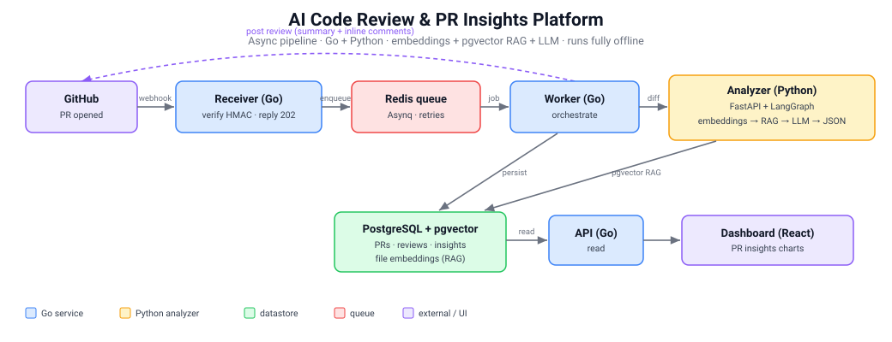

# AI Code Review & PR Insights Platform

An automated pull-request reviewer plus a PR analytics dashboard. When a PR is
opened, a GitHub webhook triggers a Go pipeline that fetches the diff, uses
**embeddings + retrieval (RAG)** to pull in related code for context, and asks
an **LLM** for review comments — which are posted back on the PR. In parallel it
computes **PR Insights** metrics (size, risk score, hotspots) shown on a React
dashboard. Everything is Dockerized, runs on Kubernetes, and has a GitHub
Actions CI.

> **Runs fully offline.** By default it uses a deterministic hash embedder and a
> heuristic mock reviewer, so you can demo the entire flow with **no GitHub
> account and no LLM API key**. Flip env vars to use real GitHub + Anthropic/OpenAI.

## Architecture



- **Async by design:** the receiver replies in milliseconds and the slow review
  happens in the worker, because GitHub times out webhooks in ~10s.
- **Two languages on purpose:** Go for fast, concurrent orchestration + GitHub
  I/O; Python for the ML/LLM ecosystem (embeddings, LangGraph).

## Components

| Path | What it is |
|---|---|
| `cmd/receiver` | Go webhook front door: verify HMAC signature → enqueue → 202 |
| `cmd/worker` | Go queue worker: idempotency → fetch diff/files → insights → analyzer → post review → persist |
| `cmd/api` | Go read API for the dashboard (`/api/stats`, `/api/prs`, `/api/hotspots`) |
| `cmd/demo` | Runs the whole review pipeline offline, no infra |
| `internal/queue` | Asynq (Redis) task type + enqueue with commit-level dedupe |
| `internal/store` | GORM/Postgres models + repos; in-memory store for demo/tests |
| `internal/insights` | PR metrics + 0..100 risk score |
| `internal/github` | webhook verify, REST client, and an **offline fixture provider** |
| `analyzer/` | Python FastAPI + LangGraph: embeddings + pgvector RAG + LLM → structured JSON |
| `web/dashboard/` | React (Vite) PR Insights dashboard |
| `deploy/k8s/` | Deployments, Services, HPA, Ingress, ConfigMap, Secret |
| `.github/workflows/ci.yml` | Build + test Go, Python, dashboard, and all images |

## Quick start — offline demo (no keys, no Docker)

```bash
# 1. start the analyzer (offline defaults: hash embeddings + mock reviewer)
cd analyzer
python3 -m venv .venv && . .venv/bin/activate
pip install -r requirements.txt
uvicorn app.main:app --port 9000      # if 9000 is taken, use --port 9111

# 2. in another shell, run the pipeline against a built-in sample PR
cd ai-code-review-mvp
ANALYZER_URL=http://127.0.0.1:9000 go run ./cmd/demo
```

You'll see a posted review with real, line-anchored findings (a nil-pointer
dereference and an ignored error) plus a risk score — produced by the full
worker → analyzer → RAG → review path.

## Run the whole platform (docker-compose)

```bash
docker-compose up --build -d       # newer Docker: docker compose up --build -d
docker-compose ps                  # wait until services are healthy/up
# dashboard: http://localhost:5173    api: http://localhost:8081
```

This starts Postgres (pgvector), Redis, and all five services, **offline by
default** (no GitHub account or LLM key needed).

Now feed it some pull requests so the dashboard fills up:

```bash
./scripts/send-sample-prs.sh       # posts signed sample PR webhooks
docker-compose logs -f worker      # watch each review happen
```

Open **http://localhost:5173** — you'll see the PRs, their risk scores, and
hotspot files. In offline mode every PR is reviewed against the same built-in
sample diff, so metrics look similar; real GitHub PRs (below) give varied data.

Tear down with `docker-compose down -v`.

## Going real (GitHub + LLM)

- Set `OFFLINE=false`, `GITHUB_TOKEN`, and `GITHUB_WEBHOOK_SECRET` for the Go
  services (see `.env.example`).
- Set `LLM_PROVIDER=anthropic` (or `openai`) and the matching API key, and
  optionally `EMBEDDINGS_PROVIDER=local|openai`, for the analyzer.
- Point a GitHub webhook (Pull request events) at the receiver's `/webhook`.

## Tests

```bash
go test ./...                              # Go: handler, insights, ...
cd analyzer && python -m pytest -q         # analyzer: patch parsing, RAG pipeline, endpoint
cd web/dashboard && npm ci && npm run build
```

## How each resume bullet maps to the code

| Resume bullet | Where it lives |
|---|---|
| Analyzes PRs & generates review suggestions using LLMs | `analyzer/app/llm.py`, `internal/worker/worker.go` |
| Integrated with GitHub webhooks; posts insights as comments | `internal/server/handler.go`, `internal/github/client.go` (`PostReview`) |
| Semantic code analysis with embeddings | `analyzer/app/embeddings.py`, `analyzer/app/vectorstore.py` (pgvector), `analyzer/app/graph.py` (RAG) |
| Deployed with Docker & Kubernetes for scalable processing | `Dockerfile`, `analyzer/Dockerfile`, `web/dashboard/Dockerfile`, `docker-compose.yml`, `deploy/k8s/` (HPA + queue) |

## Interview notes

- **Idempotency:** duplicate webhook deliveries collapse — dedupe key is
  `repo+PR+commitSHA` at both the queue (`internal/queue`) and the store
  (`Reviews` unique index).
- **Big PRs / token limits:** the diff is capped (`MAX_DIFF_BYTES`) and only the
  diff (not whole files) is reviewed; embeddings are cached by content hash.
- **Keeping the AI honest:** structured JSON output with a severity +
  confidence, and only comments above `MIN_CONFIDENCE` are posted.
- **Scaling:** stateless workers + Redis queue + HPA; the queue absorbs spikes.

See `../Downloads/AI_Code_Review_PR_Insights_Architecture.md` for the full
architecture write-up and interview Q&A.
